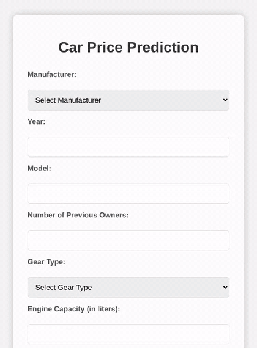

# Used-Car Price Prediction: Web App

> A used-car price model packaged as a small web app: fill in the car, get a price.

   



*A 2015 Hyundai i35 with 144,000 km, entered into the app.*

## Highlights

- Reproducible pipeline split into data preparation, training and serving.
- ElasticNet tuned by grid search with 10-fold cross-validation; model and preprocessor saved for serving.
- Flask API with an HTML form for live predictions.

## How it works

`car_data_prep.py` cleans the raw listings, `model_training.py` trains and saves the model, and `api.py` loads it and serves predictions at `/predict`.

## Repository structure

| Path | Description |
|---|---|
| `car_data_prep.py` | Cleaning: numeric parsing, imputation, IQR outlier removal, model-name cleanup |
| `model_training.py` | Split, preprocessing, ElasticNet + GridSearchCV, permutation importance, model export |
| `api.py` | Flask app: `/` form, `/predict` endpoint |
| `index.html` | Input form |
| `dataset (2).csv` | 1,500 used-car listings |

## Getting started

```bash
pip install -r requirements.txt
python model_training.py   # train and save the model
python api.py              # Flask expects index.html inside templates/
```

## Context

Final project, Advanced Data Mining and Analysis in Python. Team project by Amit Stein and Nadav Mashiach.

## Credits

The analysis and evaluation (test RMSE ₪11,057) are in [Final-project-in-a-machine-learning-course](https://github.com/steinamit/Final-project-in-a-machine-learning-course).
